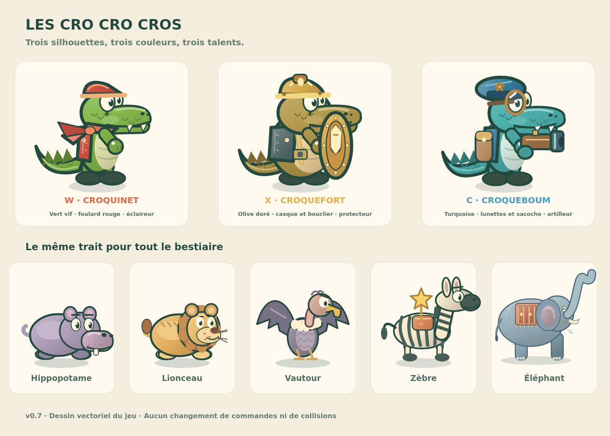

# Les Cro Cro Cros

Jeu de plateforme et d’énigmes en solo, en français, jouable hors ligne. Trois crocodiles complémentaires, 37 étapes, six chapitres et 111 étoiles facultatives.

**Version 0.8.2 — départs dégagés et leviers toujours lisibles.**



## Jouer

**[Jouer en ligne — crocrocros.vercel.app](https://crocrocros.vercel.app/)**

Télécharger [Les_Cro_Cro_Cros.html](Les_Cro_Cro_Cros.html) puis l’ouvrir dans un navigateur sur ordinateur. Le fichier est autonome ; le bouton « Raw / Download raw file » de GitHub permet de récupérer son contenu.

Pour la PWA, servir le dossier `dist/` sur HTTPS ou localement :

```sh
python3 -m http.server 8080 --directory dist --bind 127.0.0.1
```

Ouvrir `http://localhost:8080`. L’installation PWA nécessite HTTPS ou localhost et un premier chargement complet. Aucun serveur de jeu, compte ni connexion n’est requis ensuite. La configuration Vercel est prête : importer ce dépôt, conserver sa racine et déployer. `vercel.json` sert directement le dossier `dist/` déjà construit, sans dépendance à installer. Le lien avec GitHub permettra de déployer les prochains commits de `main`. Le projet Vercel `crocrocros` est relié au dépôt GitHub ; le déploiement de production a été vérifié le 20 octobre 2026.

## Commandes

- **W / X / C** : sélectionner Croquinet / Croquefort / Croqueboum.
- **← / →** : marcher ; **↑** : sauter avec Croquinet ou monter à l’échelle ; **↓** : descendre.
- **Espace** : capacité, interaction ou étoile offerte par un zèbre.
- **R** : rembobiner ; **M** : vue d’ensemble ; **Échap** : pause.

Commandes tactiles disponibles. Sur téléphone et tablette, le jeu se met en attente en portrait et reprend en paysage. Les proportions sont préservées au redimensionnement, y compris lorsque les barres de Safari changent de taille. Sur iOS 17 et ultérieur, la session audio `playback` utilise le volume multimédia, indépendamment du commutateur de sonnerie. Un média silencieux embarqué sert de compatibilité pour les anciens iOS. Un premier appui reste nécessaire. Les versions 0.8.1 et 0.8.2 conservent aussi la tentative en cours. Progression locale, export/import dans les réglages. La mise à jour 0.8 conserve les niveaux terminés et leurs étoiles ; la tentative en cours repart au début de son niveau pour charger les nouveaux placements. Pour passer du fichier local au site Vercel, exporter puis importer la progression dans les réglages.

## Des départs lisibles

Les 37 niveaux ont été vérifiés avec les dimensions complètes des personnages. Les 20 départs qui masquaient un mécanisme disposent désormais d’une courte zone libre, sans activation involontaire des dalles. Pendant le jeu, un levier recouvert par un croco s’affiche au premier plan avec son état au-dessus du personnage. Les sauvegardes 0.8/0.8.1 sont repositionnées sans perdre les actions déjà accomplies.

## Les zèbres

Cinq rencontres facultatives aux niveaux 4, 12, 19, 27 et 35, loin des sorties. Le curieux s’approche quand vous restez immobile, le gourmand s’arrête pour une boulette de Croqueboum, le flâneur alterne trot et pauses. Espace prend l’étoile quand il est prêt. Les autres niveaux retrouvent leurs étoiles fixes.

## Sources et reconstruction

- `src/` : moteur, bestiaire, dessin Canvas, musique et interface.
- `content/` : définition et génération des 37 niveaux.
- `dist/` : PWA compilée, manifeste, service worker et icônes.
- `tests/` : solutions par les commandes normales, sauvegardes, interactions et simulations d’API.
- `docs/` : planche de personnages produite par le moteur.

```sh
node content/author-campaign.cjs
python3 build.py
node tests/engine.test.js
node tests/start-visibility.test.cjs
node tests/exit.test.cjs
node tests/blocks.test.cjs
node tests/wildlife.test.cjs
node tests/pranks.test.cjs
node tests/zebra.test.cjs
node tests/music.test.cjs
node tests/package.test.cjs
```

Avant chaque commit qui modifie le jeu, reconstruire `dist/` et le HTML autonome avec les commandes ci-dessus : Vercel publie ces fichiers compilés.

Les tests d’interface et les rendus demandent `@napi-rs/canvas` dans l’environnement Node, sans dépendance pour jouer. L’aperçu vidéo facultatif demande aussi FFmpeg. Lire [LISEZ_MOI.md](LISEZ_MOI.md) pour les instructions complètes et les limites de validation ; [VALIDATION.json](VALIDATION.json) consigne les vérifications de cette version. L’installation sur appareil, le rendu CSS en navigateur réel et la difficulté ressentie nécessitent encore une validation humaine.

Les illustrations sont originales et produites par le code Canvas. L’adaptation musicale de la comptine traditionnelle est documentée dans [MUSIQUE.md](MUSIQUE.md). Les références de conception des énigmes figurent dans [CARNET_ADAPTATION.md](CARNET_ADAPTATION.md).
